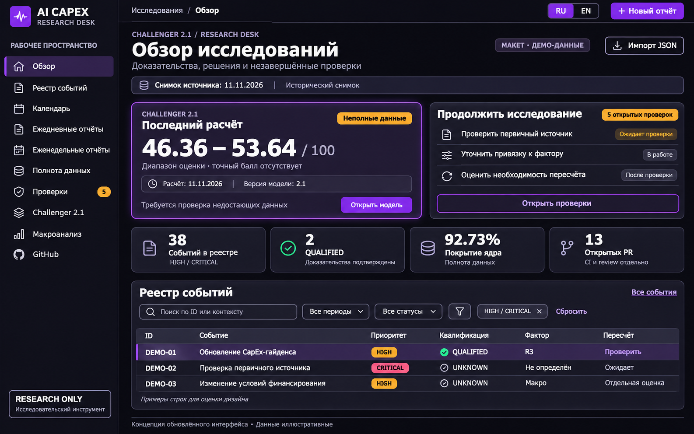

# Дизайн Research Desk

Материалы обновления дизайна WTF Viewer / AI CapEx Reversal · Research Desk от **21 ноября 2026**.

- [План повышения контраста (RU)](WTF_viewer_design_plan_RU.md): палитра, типографика, иерархия обзора, таблицы, статусы, этапы P0–P3 и критерии приёмки.
- [Макет главного экрана (PNG)](research-desk-overview-2026-11-21.png): визуальная концепция, сгенерированная по плану.

## Статус и использование

Материалы сохранены для дальнейшей реализации. Это концепция, а не уже внедрённый интерфейс. Сохранение этих файлов не меняет работающий сайт.

Данные и строки макета иллюстративные. Часть чисел взята из исторического снимка приложения от 11 ноября 2026; они не являются актуальными значениями на дату подготовки макета. Строки DEMO-01–DEMO-03 не регистрируют реальные события. Не использовать изображение как источник для Challenger, реестра событий или текущих статусов проверок.

Общий приоритет реализации: читаемость и разделение поверхностей; главный блок Challenger и открытые проверки; реестр и карточка события; остальные экраны; проверка доступности и адаптивности. Точные требования находятся в плане.

Перед внедрением нужно проверить фактические состояния приложения и контраст CSS-цветов. Сгенерированный макет может содержать неточности текста, пропорций и стилизации; правила модели и исходные данные определяются спецификацией и исследовательскими источниками.

## Происхождение

- Референс: [ID Agent — Process](https://www.idagent.pro/#process).
- Приложение: [AI CapEx Reversal · Research Desk](https://ai-capex-reversal-desk.silveryopera8.chatgpt.site).
- Sites project ID: `appgprj_6af488a9252481919df8e2a0e4fdeada`.
- PNG сохранён без перекодирования: **1586 × 992**, **1 631 281 байт**.
- SHA-256 PNG: `e6d2a6fcbbb9c8b4dc9c65d899fd2e5537e5959dc71e74227cddd42f7e419af8`.
