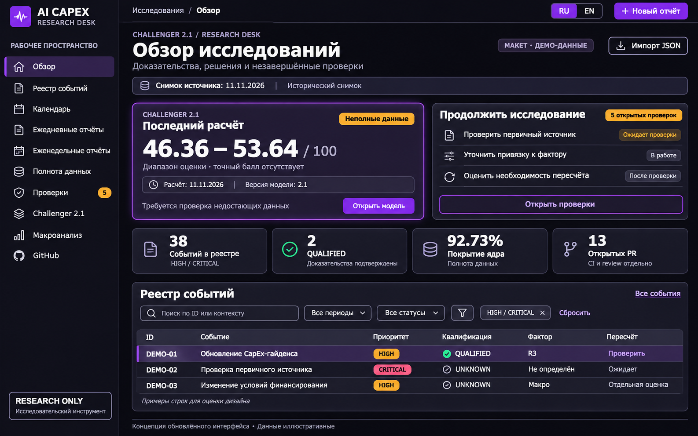

# WTF Viewer / Research Desk — дизайн-приложение к выпуску v1.2
Дата: 21 ноября 2026 · Статус: PLAN_INTEGRATED; внедрение D0–D3 и приёмка D01–D06 не начаты.

## Назначение первой версии после согласования 1.1–1.4

[Решения 21.11.2026](../PHASE1_SCOPE_DECISIONS_RU.md) уточняют этот дизайн: первая версия показывает полные исследования/daily/weekly из GitHub WTF-Viewer и импортированные статусы, поддерживает ручной пакетный импорт и чистый пересчёт Challenger по кнопке/reload. После проверенного переноса WTF-Viewer становится основным источником; AI_CapEx_Reversal сохраняет origin history. До cutover показывать фактический источник.

Приоритеты экранов: обзор; списки и reader исследований/отчётов с источниками/GitHub file/version; импорт с revision/provenance; Challenger с опубликованным и отдельным LOCAL/UNPUBLISHED результатом. Кнопка «Пересчитать Challenger» и состояние входов/ошибок обязательны. Обновление страницы не выглядит как новая публикация/экономический аудит.

Сайтовые заметки, «Новый отчёт»/редактор, ручная квалификация и запись в GitHub относятся к последующей редакторской версии. Наличие таких элементов на исходном PNG не делает их обязательными для первого выпуска. Существующий Site login не удаляется; будущие права относятся к редактированию.

## Связь с общим планом v1.2

Это подробное приложение к [единому плану выпуска](../UPDATE_PLAN_RU.md), а не отдельный календарный план или релиз. Порядок и зависимости D0–D3 задаются общим планом; продуктовые требования — [ТЗ v1.2 RU/EN](../SPEC_RU_EN.md); обязательные статусы первой версии B01–B10/D01–D06 и исходный backlog A01–A18 — [реестром приёмки](../ACCEPTANCE_TRACKER.md). Наличие плана или PNG не означает выполнения дизайн-задач.

| Группа приложения | Место в выпуске v1.2 |
| --- | --- |
| P0 — читаемость и каркас | D0 после этапа 0; подготовка во время 1–2, завершение до визуальных изменений 3; общие компоненты затем применяются ко всем экранам |
| P1 — обзор, реестр, карточка | Макеты в D0; реализация в D1 на этапах 3–4 после соответствующих контрактов данных |
| P2 — остальные представления | D1 на этапах 3–5 по готовности сценариев; единый охват и устранение пробелов в D2/этапе 6 |
| P3 — проверка и внедрение | Проверка компонентов по ходу работ; завершение D2 на этапе 6, повторная приёмка D3/D01–D06 на релизном SHA в этапе 7 |

P0–P3 — группы визуальных задач, не замена этапам 0–7. Функциональные и визуальные изменения оформляются отдельными коммитами/PR с явной зависимостью и входят в один выпуск.

## Бренд, макет и приоритет требований

Постоянная иерархия интерфейса: **WTF Viewer → AI CapEx Signals → Challenger 2.1**. «Research Desk» — название существующей публикации, не новый верхний бренд. В исходном PNG надпись AI CAPEX остаётся частью исторической концепции; в реализации её верхний уровень заменяется на WTF Viewer, workspace показывается отдельно. PNG не перерисован и не является точной спецификацией.

Методологию и данные определяют канонические исследовательские контракты; значения статусов и продукт — ТЗ; порядок — общий план; оформление — это приложение. При расхождении картинки и текстовых требований следовать тексту. Старое требование сохранить внешний вид и зелёные общие акценты заменено на новый контрастный дизайн с сохранением данных, сценариев и контекста.

Обзор — единственный подготовленный визуальный макет. Список/reader отчёта, импорт/пересчёт, реестр и карточка события требуют проработки в D0. Реализация использует общие компоненты и фактические выборки. Числа, DEMO-строки, даты и открытые проверки из PNG не создают записи, не определяют актуальность и не становятся константами приложения.

## Основание и границы анализа
Референс: https://www.idagent.pro/#process — визуально изучен блок Process и его стили.
Текущее приложение: https://ai-capex-reversal-desk.silveryopera8.chatgpt.site — изучен сохранённый снимок опубликованной версии 2. Живой интерфейс требует входа; состояния вложенных экранов не проверены. Замечания к реестру, календарю и деталям ниже являются проектными предложениями для последующей проверки, а не результатами полного аудита этих экранов.
Это план дизайнерских изменений. Код, данные, расчёты и публикация приложения не изменены.

## Выбранное направление
Контрастный тёмный исследовательский интерфейс: нейтральный почти чёрный фон, более светлые поверхности, белые заголовки, фиолетовый акцент на действиях и выбранных элементах. Цвета риска и достоверности имеют отдельные значения.

## Что работает у ID Agent и как это адаптировать
- Крупные белые заголовки и жирное начертание создают ясную иерархию. В Process заголовок секции — Raleway 48px/800, заголовки карточек — 18px/700. Для плотного рабочего интерфейса Research Desk предлагаются меньшие размеры.
- Фон Process — #141020; фиолетовая основная кнопка — #8606C1 с белым текстом. Это измеренные цвета референса, а не обязательные цвета приложения.
- Три карточки образуют понятную группу. Центральная карточка выделена фиолетовым фоном, рамкой и свечением; небольшие встроенные панели показывают результат работы.
- Зелёный используется для подтверждённого действия. В Research Desk зелёный следует закрепить за QUALIFIED или завершённой проверкой и обязательно пояснять подписью: квалификация не означает благоприятного направления события.
- В рабочем интерфейсе использовать компактные отступы и ограниченное свечение только для одного смыслового акцента. Большие заголовки и пространство лендинга уменьшать до масштаба приложения.

## Наблюдения по текущему снимку
1. Тёмные зеленоватые фон, карточки и sidebar визуально сливаются.
2. Вторичные подписи, даты и служебные сообщения выглядят мелкими и тусклыми; точные коэффициенты контраста текущего CSS не измерены.
3. Лаймовый цвет повторяется в навигации, кнопках, метриках и индикаторах, что ослабляет различие функций.
4. Четыре счётчика имеют сопоставимый визуальный вес, хотя открытая проверка требует действия, а число событий представляет справочную информацию.
5. Блок Challenger конкурирует с окружающими панелями. Диапазон, неполноту данных и дату расчёта полезно объединить в более сильную композицию.

## Предлагаемые цветовые токены
Все значения ниже — новая предлагаемая палитра, не копия CSS референса.

| Назначение | Цвет |
|---|---|
| Фон страницы | #0B0B12 |
| Навигация и базовые панели | #14141F |
| Карточки, фильтры | #1C1C2A |
| Hover / выбранная поверхность | #292339 |
| Разделители панелей | #3B3B50 |
| Границы полей, если нужны для распознавания | #73738C |
| Основной текст | #F5F5FA |
| Вторичный текст | #B8B8CA |
| Дополнительные подписи | #9999B0 |
| Primary button | #7C3AED с белым текстом |
| Ссылки, выбранный элемент, focus | #C4B5FD |
| QUALIFIED / завершено | #34D399 |
| HIGH / предупреждение | #FBBF24 |
| CRITICAL / ошибка | #FB7185 |
| UNKNOWN | #CBD5E1 |

Поверхности и разделители помогают группировке; отдельные контрастные границы нужны для контролов там, где без них трудно распознать поле. Не делать всю таблицу сеткой ярких линий.

## План по приоритетам

### P0. Читаемость и общий каркас
- Ввести общие токены цвета, шрифта, отступов, рамок и состояний.
- Убрать общий зеленоватый оттенок поверхностей; светлый лайм заменить фиолетовым акцентом.
- Основной текст 16px; таблицы, фильтры, статусы и важные даты — минимум 14px; 12–13px оставить только для необязательных метаданных.
- Заголовок страницы 28–32px/700; секции 18–20px/650–700; основные показатели 36–44px.
- Сохранить текущий шрифт, если он хорошо читается на русском и английском; оценить Inter или другой интерфейсный гротеск при макетировании. Для чисел включить tabular-nums.
- Активный пункт sidebar: светлый текст, фиолетовый фон и боковой маркер. Неактивные пункты сделать читаемыми.
- Рекомендуемые радиусы: панели 12–16px, поля и кнопки 8–10px.

Результат: обзор и навигация с новой системой оформления.

### P1. Полные исследования и отчёты

- Два самостоятельных списка daily/weekly и список исследований из manifest; поиск, период, статус и источник GitHub WTF-Viewer.
- Полный Markdown-reader с вложениями/первичными ссылками, source/target paths и commit, датой/периодом/cutoff; metadata-only карточку не выдавать за полный текст.
- Статусы файла, комплектности и review/workflow различаются; редактор текста/сайтовые заметки не входят в первую версию.

### P1. Импорт и пересчёт

- Предпросмотр пакета с target GitHub commit, датой/cutoff, hash/version и пробелами; published bundle и локальный preview визуально различимы.
- «Пересчитать Challenger»: выбранные входы и evaluation_as_of, причины невозможности расчёта, progress/error/success; повторный reload/cache без дублирующих записей.
- LOCAL/UNPUBLISHED результат рядом с опубликованным артефактом, раздельные даты/hash/versions, download JSON без утверждения о публикации.

### P1. Иерархия обзора
- Выделить Challenger крупнее остальных карточек: значение или диапазон, статус полноты, дата расчёта, версия модели, основание изменения.
- Показать неполноту явно текстом. Не превращать диапазон в точечный балл; отсутствие данных обозначать «нет данных», а не нулём.
- Сохранить различие времени обновления приложения, даты снимка источника и даты расчёта.
- Открытые проверки и необходимость пересчёта сделать заметными блоками с понятным следующим действием. При отсутствии оснований показывать нейтральное состояние.
- Счётчики событий, QUALIFIED и PR визуально подчинить основному исследовательскому выводу.
- Выбранную или требующую следующего действия карточку выделять рамкой как у центральной карточки Process. Открытый PR сам по себе не окрашивать как ошибку.
- Сообщения о входе, сохранении и проблемах данных оформить разными типами уведомлений с ясными подписями.

Результат: макет обзора с понятным приоритетом информации.

### P1. Реестр событий и карточка события
- Закреплённая шапка таблицы, отчётливый hover и выбранная строка, умеренное чередование фонов.
- Первый уровень строки: дата события, заголовок, приоритет. Следом: статус доказательств, фактор Challenger и решение о пересчёте.
- Дату публикации и дату факта показывать с разными подписями.
- Разделить визуально приоритет HIGH/CRITICAL, квалификацию QUALIFIED/UNKNOWN/failed, направление влияния и решение о пересчёте.
- Квалификацию передавать значком и текстом; направление влияния подписывать отдельно.
- В деталях события выделить вывод, доказательства, первичные источники и следующее действие.
- Первоначальную и итоговую оценку показывать рядом с понятными подписями.
- Основные фильтры оставить видимыми, дополнительные раскрывать; активные фильтры показывать чипами с возможностью сброса.

Результат: макет реестра и открытой карточки события.

### P2. Остальные представления
- Календарь: заметный текущий день, различимые события HIGH/CRITICAL, отдельная индикация пропуска отчёта.
- Проверки: выделить блокирующую причину, последнее действие и следующий шаг; сохранять компактность описания контекста.
- Challenger R1–R7: единое оформление значений, источников и отсутствующих данных; границы интервала в графике показывать явно.
- Полнота отчётов: отличать «нет отчёта», «проверка не завершена» и «событий не найдено» текстом и символом.
- GitHub: CI, review и merge показывать самостоятельными статусами.
- Макроанализ: отдельная визуальная секция с индивидуальной и совокупной оценкой; не смешивать её с квалификацией конкретного фактора.

Результат: распространение утверждённых компонентов на остальные экраны.

### P3. Проверка и внедрение

1. В D0 подготовить стили и комплект макетов: обзор, список/reader отчёта, импорт/пересчёт, реестр и карточка события. Сейчас готов только исходный обзор; остальные не считать выполненными.
2. Применять проверенные компоненты в D1 на этапах 3–5; завершить общий охват в D2/этапе 6. D3/этап 7 проверяет итог, не откладывает макетирование до конца.
3. Проверить RU/EN, длинные названия, пустые результаты, загрузку, ошибку, UNKNOWN и неполные данные.
4. Проверить размеры 1440, 1280, 768 и 390px. На узком экране оставить ID, дату, приоритет, статус и доступ к деталям.
5. Проверить клавиатуру, видимый focus, масштаб 200%, отсутствие перекрытия контента закреплёнными панелями.
6. Измерить контраст по фактическим CSS-цветам во всех состояниях, включая hover и выбранные строки.

## Критерии приёмки

Проверяются как D01–D06 из общего плана вместе с B01–B10; A01–A18 остаются backlog полной панели с явной применимостью; доказательства и статусы — в едином реестре. Обязательны и корректная иерархия бренда, и доступность всех рабочих сценариев; совпадение с PNG само по себе не даёт PASS.
- Обычный текст — минимум 4.5:1 к фону; крупный — минимум 3:1. Крупный текст: от 24 CSS px обычного либо от 18.67 CSS px жирного; измерять фактические CSS-цвета с учётом фоновых слоёв.
- Значимые визуальные признаки контролов и графиков — минимум 3:1 к соседним цветам, где применяется WCAG.
- Для основного текста проекта целевой контраст 7:1 желателен; обязательный порог определяется предыдущими пунктами, это не отдельный блокер релиза.
- Критический статус читается без распознавания цвета.
- На обзоре быстро находятся опубликованный результат Challenger и отдельный локальный пересчёт, даты/as_of, полнота данных и следующая незавершённая проверка из источника.
- На мобильном доступны все ключевые данные и действия.
- Существующие данные, полные тексты, ссылки, фильтры и импортированные ручные статусы сохранены; формулы и правила исследования остаются прежними. Паритет вычислительного ядра проверяется по B07, не по визуальному PNG.
- В верхнем уровне — WTF Viewer; AI CapEx Signals и Challenger 2.1 показаны отдельно. QUALIFIED не означает благоприятное направление события; CI, review и merge не объединяются.

## Источники
- Референс: https://www.idagent.pro/#process
- Опубликованное приложение: https://ai-capex-reversal-desk.silveryopera8.chatgpt.site
- W3C, Contrast Minimum: https://www.w3.org/WAI/WCAG22/Understanding/contrast-minimum.html
- W3C, Non-text Contrast: https://www.w3.org/WAI/WCAG22/Understanding/non-text-contrast.html

## Связанный макет

[Макет главного экрана](research-desk-overview-2026-11-21.png) — сгенерированная визуальная концепция по этому плану. Надписи и демонстрационные строки не являются подтверждёнными исследовательскими данными. Макет не заменяет реализацию и проверку доступности.

